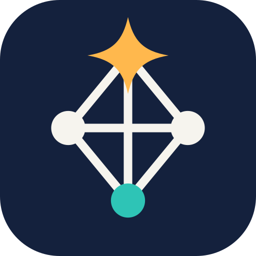

<p align="center">
  
</p>

<h1 align="center">Trellis</h1>

<p align="center">
  A real-time collaborative system design workspace powered by AI.<br/>
  Describe your architecture in plain English — Trellis maps it onto a shared canvas.<br/>
  Collaborators refine the design together, then export a technical specification.
</p>

<p align="center">
  
  
  
  
  
</p>

---

## Features

| | |
|---|---|
| **AI Architecture Generation** | Prompt the AI to generate or extend a system design. Nodes and edges are written directly into the shared canvas as a durable background task. |
| **Real-time Collaboration** | Multiple users edit the same canvas simultaneously with live cursors and presence avatars. |
| **Starter Templates** | Import prebuilt system designs — microservices, event-driven, CI/CD pipeline, and more. |
| **Canvas Editing** | Drag-and-drop shapes, resize nodes, draw connections, edit labels inline, and color-code components. |
| **Spec Generation** | Convert the final canvas graph into a Markdown technical specification. Download or copy the result. |
| **Project Management** | Create, rename, and delete projects. Invite collaborators by email and manage access. |
| **Autosave** | Canvas state is debounce-saved to cloud blob storage and restored on re-entry. |

---

## Tech Stack

| Layer | Technology |
|---|---|
| Framework | Next.js 16 + TypeScript (strict) |
| UI | Tailwind CSS v4 + shadcn/ui |
| Auth | Clerk v7 |
| Database | PostgreSQL · Prisma 7 · Prisma Accelerate |
| Real-time canvas | Liveblocks + React Flow |
| Background tasks | Trigger.dev v4 |
| AI | Google Gemini 2.5 Flash via Vercel AI SDK |
| Artifact storage | Vercel Blob |

---

## Getting Started

### Prerequisites

- Node.js 20+
- PostgreSQL database (or a Prisma Accelerate connection string)
- Accounts: [Clerk](https://clerk.com), [Liveblocks](https://liveblocks.io), [Trigger.dev](https://trigger.dev), [Vercel Blob](https://vercel.com/storage/blob), [Google AI Studio](https://aistudio.google.com)

### Environment Variables

```env
# Clerk
NEXT_PUBLIC_CLERK_PUBLISHABLE_KEY=
CLERK_SECRET_KEY=
NEXT_PUBLIC_CLERK_SIGN_IN_URL=/sign-in
NEXT_PUBLIC_CLERK_SIGN_UP_URL=/sign-up

# Database
DATABASE_URL=

# Liveblocks
LIVEBLOCKS_SECRET_KEY=

# Trigger.dev
TRIGGER_SECRET_KEY=

# Vercel Blob
BLOB_READ_WRITE_TOKEN=

# Google AI
GOOGLE_GENERATIVE_AI_API_KEY=
```

### Install and Run

```bash
npm install
npx prisma migrate deploy
npm run dev
```

> AI features require the Trigger.dev dev server running in a separate terminal:
> ```bash
> npx trigger.dev@latest dev
> ```

---

## Project Structure

```
app/
  api/            Route handlers — auth, projects, canvas, AI tasks
  editor/         Project list home + workspace pages
  sign-in/
  sign-up/
components/
  editor/         Workspace shell, navbar, sidebars, canvas surfaces
  ui/             shadcn primitives
hooks/            Autosave, keyboard shortcuts, project actions
lib/              Prisma client, auth helpers, Liveblocks client, templates
prisma/           Schema models and migrations
src/trigger/      Durable AI background tasks (design agent, spec agent)
types/            Shared TypeScript types
proxy.ts          Next.js 16 middleware — Clerk route protection
```

---

## Architecture Notes

- **Canvas state** lives in Liveblocks rooms. Snapshots persist to Vercel Blob and reload on room entry when the room is empty — protecting active collaborators from overwrites.
- **AI tasks** run as durable Trigger.dev background jobs. The API route triggers the job and returns a `runId`; the client subscribes via `useRealtimeRun` for live status updates.
- **Specs** are generated by reading the Liveblocks canvas, calling Gemini, and uploading the result to Vercel Blob at `specs/{projectId}/{timestamp}.md`.
- **Auth and ownership** are enforced at every API mutation boundary — Clerk session + Prisma ownership checks on every write.

---

## License

Private.
